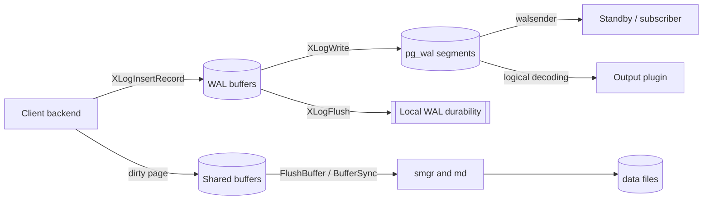

# System map: processes, shared memory, WAL, and storage

PostgreSQL is a multi-process system with shared-memory structures and a
cluster-wide write-ahead log. This page fixes the vocabulary and the handoffs that the rest
of the wiki depends on: how the postmaster hands work to child processes, what
lives in shared memory, and the distinct relation-data and WAL-file write paths. Relation data passes
through `smgr`; WAL segment I/O is managed by the WAL subsystem.

## Process model and the postmaster handoff

The postmaster is the parent supervisor. `PostmasterMain()` parses
configuration and enters `ServerLoop()`, which accepts connections and manages
child state; dead children are reaped in `process_pm_child_exit()`.

| Child | Started by | Role |
| --- | --- | --- |
| Backend | `BackendStartup` on an accepted connection | Serves one client connection |
| Auxiliary and other built-in children | `StartChildProcess` | Checkpointer, background writer, WAL writer, autovacuum launcher, WAL receiver, archiver, ... |
| WAL sender | forked on a replication connection | Streams WAL to a standby or logical subscriber |
| Background workers | `StartBackgroundWorker` | Extension-defined workers |

Ordinary client backends are launched by `BackendStartup()` through
`postmaster_child_launch(B_BACKEND, ...)`. `StartChildProcess()` launches
specified built-in child types. Do not treat `AuxiliaryProcessMain()` as the
entry point for ordinary client backends.

Source: `src/backend/postmaster/postmaster.c` (`PostmasterMain`,
`ServerLoop`, `StartChildProcess`, `process_pm_child_exit`).

## Shared memory

Almost everything that must be visible across processes lives in the shared
memory segment created at startup by `CreateSharedMemoryAndSemaphores()`.
`shmem.c` provides the allocator and the lookup index for named structures.

In shared memory you find, among others:

- The shared buffer pool and its buffer descriptors.
- WAL buffers plus insert/flush positions (`XLogCtl`).
- LWLocks, the lock manager tables, and predicate-lock data.
- The `ProcArray` and the snapshot/serializable infrastructure.
- Replication slot state (`ReplicationSlotCtl`).

Source: `src/backend/storage/ipc/ipci.c` (`CreateSharedMemoryAndSemaphores`),
`src/backend/storage/ipc/shmem.c`.

## Two write paths: shared buffers and WAL

Both persistent changes and their WAL records follow a buffer-then-flush
discipline. Understanding the two paths is the key to reading the replication,
I/O, and performance pages.

### Data path: shared buffer -> smgr

A relation read goes through `ReadBuffer_common()`, which locates the block in
the shared buffer pool or reads it via `smgr`. A dirty buffer is written by
`FlushBuffer()`, which calls the storage manager; `md.c` implements that with
`mdwritev()` (and `mdwriteback()`/`mdimmedsync()` for writeback and immediate
durability), and `register_dirty_segment()` drives fsync requests.

The checkpointer uses `BufferSync()` to mark checkpoint-required dirty buffers
with `BM_CHECKPOINT_NEEDED` and write that set. Regular checkpoints normally
select permanent buffers; shutdown and explicit flags broaden the set. Buffers
dirtied later need not all be written by this checkpoint. The background writer
uses `BgBufferSync()` to clean reusable buffers.

Source: `src/backend/storage/buffer/bufmgr.c` (`ReadBuffer_common`,
`FlushBuffer`, `BufferSync`, `BgBufferSync`),
`src/backend/storage/smgr/md.c` (`mdwritev`, `mdimmedsync`,
`register_dirty_segment`).

### WAL path: insert -> write -> flush

WAL records are produced by `XLogInsertRecord()`. A record first reserves space
in the WAL buffers (`ReserveXLogInsertLocation()`); when the current WAL page is
exhausted, `AdvanceXLInsertBuffer()` installs the next page. `XLogWrite()` moves
buffered WAL out to segment files, and `XLogFlush()` makes a record durable
for commits requiring synchronous local WAL durability. `XLogBackgroundFlush()` lets the WAL
writer flush periodically.

`synchronous_commit=off` can acknowledge a transaction before its WAL is flushed,
subject to forced synchronous cases in `RecordTransactionCommit()`. Sender-local
flush and standby write, flush, and replay positions are distinct.
`xlogrecovery.c` consumes WAL records during recovery.

Source: `src/backend/access/transam/xlog.c` (`XLogInsertRecord`,
`ReserveXLogInsertLocation`, `AdvanceXLInsertBuffer`, `XLogWrite`,
`XLogFlush`, `XLogBackgroundFlush`),
`src/backend/access/transam/xlogrecovery.c`.

## Where replication plugs in

- **WAL sender** streams records produced by the WAL path to a standby or
  subscriber; see [WAL sender](../replication/walsender.md).
- **WAL receiver** on a standby appends received WAL and lets the startup
  process replay it; see
  [WAL receiver and hot standby](../replication/walreceiver-and-hot-standby.md).
- **Logical decoding** interprets row and transaction changes from WAL using
  historic catalog snapshots and emits a plugin stream; see
  [Logical decoding](../replication/logical-decoding.md).
- **Replication slots** retain the WAL this streaming depends on; see
  [Replication slots](../replication/replication-slots.md).

## Flow summary

## Reading order

1. [Quickstart](../quickstart.md) — route a task to the right page.
2. [WAL I/O, WAL buffers, and the buffer manager](../io/wal-io-and-buffering.md)
   — the durable write path in depth.
3. [WAL sender](../replication/walsender.md) and
   [WAL receiver and hot standby](../replication/walreceiver-and-hot-standby.md)
   — how WAL leaves and re-enters the system.
4. [Scalability and contention](../performance/scalability-and-contention.md)
   — how the shared-memory structures above become bottlenecks.
