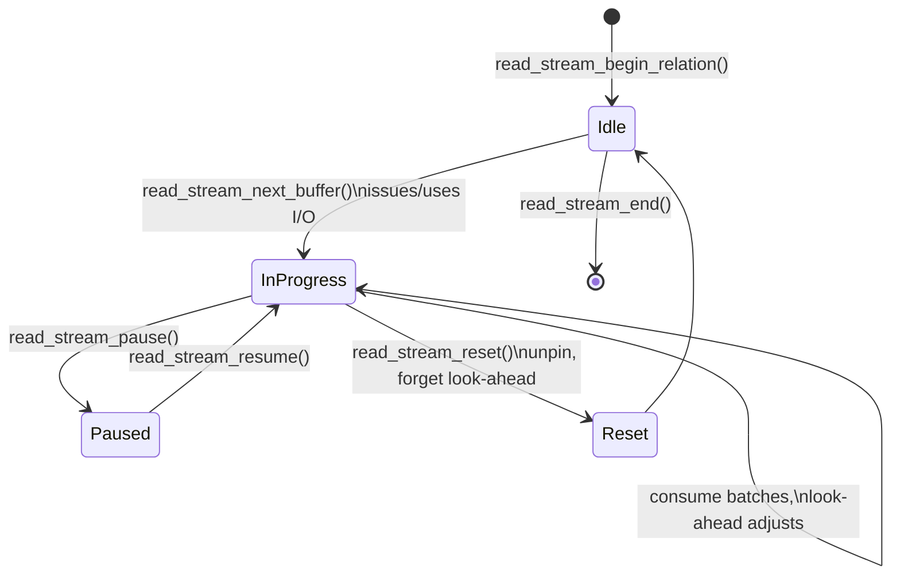

# Asynchronous I/O and ReadStream

PostgreSQL's asynchronous I/O layer lets a backend start a read (or write) and
do other work until it needs the result. `ReadStream` builds on that layer to
provide buffered relation access with look-ahead. Together they are the modern
answer to "prefetch and control I/O without relying solely on the OS".

See `src/backend/storage/aio/README.md` for the design rationale: AIO is
motivated by controlled prefetch and opportunities such as asynchronous
`fdatasync()`. These are design motivations, not a statement that every proposed
operation or direct-I/O benefit is implemented in this checkout.

## The AIO handle model

A user of AIO works with three objects:

- `PgAioHandle` — one in-flight operation. Acquired with `pgaio_io_acquire()`
  (or `pgaio_io_acquire_nb()` when blocking is unacceptable).
  `pgaio_io_release()` returns a handed-out handle that was not needed; it is
  not a generic release call for an already submitted operation.
- `PgAioReturn` — backend-local result storage that must stay alive until the
  I/O completes or the resource owner is released.
- `PgAioWaitRef` — a reference, obtained with `pgaio_io_get_wref()`, that any
  process can wait on for completion.

Typed helpers in `aio_io.c` (`pgaio_io_start_readv()`,
`pgaio_io_start_writev()`) start operations through the AIO machinery. Completion
is processed by `pgaio_io_process_completion()`, which runs the callbacks
registered on the handle (for example, buffer completion callbacks that publish
a buffer to other backends).

Acquisition is integrated with the resource owner subsystem
(`pgaio_io_resowner_register()`), so an error path releases references safely.

Sources: `src/backend/storage/aio/aio.c` (`pgaio_io_acquire`,
`pgaio_io_acquire_nb`, `pgaio_io_release`, `pgaio_io_get_wref`,
`pgaio_io_process_completion`, `pgaio_io_perform_synchronously`),
`src/backend/storage/aio/aio_io.c` (`pgaio_io_start_readv`,
`pgaio_io_start_writev`, `pgaio_io_perform_synchronously`).

## I/O methods: sync, worker, io_uring

The `io_method` GUC selects the implementation. `io_method_options` maps it to
`IOMETHOD_SYNC`, `IOMETHOD_WORKER`, and — when compiled in — `IOMETHOD_IO_URING`.
The default is `DEFAULT_IO_METHOD`. `assign_io_method` points the global
`pgaio_method_ops` at the matching `IoMethodOps` table entry; all dispatch goes
through that function table.

| Method | Implementation | Model |
| --- | --- | --- |
| `sync` | `method_sync.c` | Blocking I/O performed in the calling backend |
| `worker` | `method_worker.c` | I/O workers consume from a shared-memory submission queue |
| `io_uring` | `method_io_uring.c` | Linux `io_uring`; one ring per backend |

`io_max_concurrency` bounds outstanding I/O. Method-specific shared-memory setup
is done through `IoMethodOps->shmem_callbacks` (`request_fn`, `init_fn`,
`attach_fn`) during `aio_init.c`, and per-backend setup through `init_backend`.

**Worker method.** I/O workers consume from a shared submission queue and a
pool stabilizes around recently needed concurrency. `pgaio_worker_needs_synchronous_execution()`
requires synchronous execution when not under the postmaster, when the handle
references backend-local memory, or when the target cannot be reopened by a
worker. These are distinct from a caller explicitly requesting synchronous I/O.

**io_uring method.** There is currently one `io_uring` instance per backend, held
in a `PgAioUringContext` with an `struct io_uring io_uring_ring`. The comment at
the top of the file explains that a single global ring would require extra
locking, so per-backend rings are used. Completions for one backend's ring may
be processed by multiple backends under a completion lock.

Sources: `src/backend/storage/aio/aio.c` (`io_method_options`,
`pgaio_method_ops_table`, `pgaio_method_ops`),
`src/backend/storage/aio/aio_init.c`, `src/backend/storage/aio/method_worker.c`
(`pgaio_worker_ops`, `pgaio_worker_submit`,
`pgaio_worker_needs_synchronous_execution`),
`src/backend/storage/aio/method_io_uring.c` (`pgaio_uring_ops`,
`pgaio_uring_submit`, `pgaio_uring_init_backend`).

## ReadStream

`ReadStream` gives a caller a sequence of buffers with look-ahead, without the
caller managing AIO directly. A block-number callback supplies the next block to
read; `ReadStream` decides when to issue I/O and how far ahead to look.

Lifecycle:

- **Create**: `read_stream_begin_relation()` /
  `read_stream_begin_smgr_relation()` with a `ReadStreamBlockNumberCB` callback.
- **Consume**: `read_stream_next_buffer()` returns pinned buffers;
  `read_stream_next_block()` consumes the next block number and reports the
  access strategy when the caller wants to read that block itself. It does not
  return a pinned buffer or a completed read.
- **Tune**: look-ahead and I/O-combining distances are adjusted by
  `read_stream_should_look_ahead()`, `read_stream_should_issue_now()`, and
  `read_stream_look_ahead()`.
- **Reset**: `read_stream_reset()` stops look-ahead, forgets pending reads,
  unpins unconsumed buffers, and restarts as if data were cached.
- **Free**: `read_stream_end()` calls reset then frees the stream.

### Flags

Flags (`src/include/storage/read_stream.h`) shape behavior:

| Flag | Effect |
| --- | --- |
| `READ_STREAM_MAINTENANCE` | Governed by `maintenance_io_concurrency` (VACUUM, CREATE INDEX) |
| `READ_STREAM_SEQUENTIAL` | Suppress automatic prefetch advice; let the kernel detect sequential access |
| `READ_STREAM_FULL` | Disable the ramp-up from small reads; read all available buffers |
| `READ_STREAM_USE_BATCHING` | Opt into AIO batch mode; imposes callback restrictions |

`read_stream_enable_stats()` attaches an `IOStats` counter set so callers can
observe how much I/O and cache reuse the stream produced.

Sources: `src/include/storage/read_stream.h`,
`src/backend/storage/aio/read_stream.c` (`read_stream_begin_relation`,
`read_stream_next_buffer`, `read_stream_next_block`, `read_stream_look_ahead`,
`read_stream_should_look_ahead`, `read_stream_should_issue_now`,
`read_stream_reset`, `read_stream_end`, `read_stream_pause`,
`read_stream_resume`, `read_stream_enable_stats`).

## Where it is used

ReadStream is a relation-block abstraction used, for example, by heap scans
and VACUUM. Its callbacks supply relation block numbers and consumers receive
pinned relation buffers.

WAL records have a separate reader: logical decoding uses `XLogReaderState`
and `XLogReadRecord()`, as shown in `DecodingContextFindStartpoint()`.
ReadStream is not the WAL-segment reader. See
[Logical decoding](../replication/logical-decoding.md) for that pipeline and
[WAL I/O, WAL buffers, and the buffer manager](./wal-io-and-buffering.md) for
the write side.

For AIO lifecycle regression coverage, start with
`src/test/modules/test_aio/test_aio.c` and its handle acquisition/release tests;
this is a test entry point, not evidence of measured performance.
