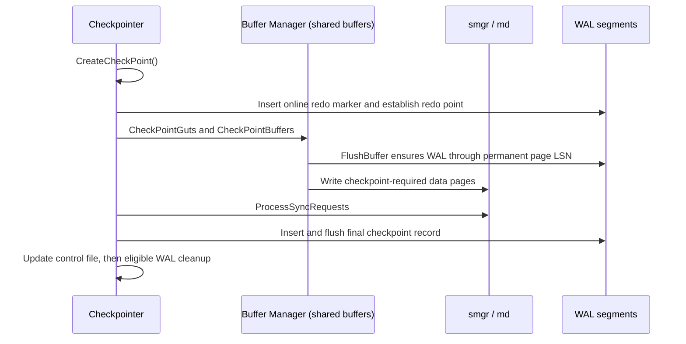

# WAL I/O, WAL buffers, and the buffer manager

Two independent but coupled write paths make changes durable: the WAL path
(record then flush) and the data path (dirty shared buffer then smgr). This page
covers both, plus the checkpoint machinery that bounds how much WAL must be
retained.

## WAL insertion and WAL buffers

A WAL record is emitted by `XLogInsertRecord()`. Insertion reserves space in the
shared WAL buffers with `ReserveXLogInsertLocation()`. Concurrent inserters
coordinate through WAL insertion locks:

- `WALInsertLockAcquire()` / `WALInsertLockAcquireExclusive()`
- `WALInsertLockRelease()`
- `WALInsertLockUpdateInsertingAt()`

When the current WAL buffer page is exhausted, `AdvanceXLInsertBuffer()` makes
the next page available, writing out the previous one if necessary.

## Flush path to durable WAL

`XLogWrite()` writes buffered WAL to segment files; `XLogFlush()` makes a given
WAL position durable. Commits requiring synchronous local durability call it;
`RecordTransactionCommit()` also has an asynchronous branch that registers an
LSN for later flushing, so commit acknowledgement alone does not imply a flush.
The WAL writer uses `XLogBackgroundFlush()` to flush proactively.

Segment open/create/install and cleanup are handled by `XLogFileOpen()`,
`XLogFileInit()`, `InstallXLogFileSegment()`, and `RemoveOldXlogFiles()`.

## Segment naming and lifecycle

WAL files live under `pg_wal` and are named by timeline and segment number.
`XLogFileName()` and `XLogFilePath()` (with `XLOG_FNAME_LEN` == 24) build those
names. `wal_segment_size` is restricted to the range 1 MB to 1 GB. Old segments
are recycled or removed once they fall behind the last redo pointer and are no
longer needed by any consumer (including replication slots).

Source: `src/include/access/xlog_internal.h` (`XLogFileName`,
`XLogFilePath`, `XLOG_FNAME_LEN`), `src/backend/access/transam/xlog.c`
(`XLogFileInit`, `InstallXLogFileSegment`, `RemoveOldXlogFiles`).

## Checkpoints and the redo point

`CreateCheckPoint()` coordinates a checkpoint and calls `CheckPointGuts()`,
which flushes data buffers via `CheckPointBuffers()` -> `BufferSync()`.
`GetRedoRecPtr()` / `GetFullPageWriteInfo()` expose the redo pointer that
decides whether full-page writes are needed; a checkpoint advances that pointer,
which establishes a new recovery starting point. Slots and archiving impose
additional retention constraints; checkpoint completion alone does not permit
all older WAL to be removed.

For an online checkpoint in this checkout, `XLOG_CHECKPOINT_REDO` establishes
the redo point before the main data-write phase. `CheckPointGuts()` writes
checkpoint data and performs queued fsyncs. Only afterward does the checkpointer
insert and flush the final checkpoint record and update the control file.
`FlushBuffer()` enforces WAL-before-data for permanent buffers by flushing
through the page LSN before the data write. The redo marker itself is not
unconditionally flushed at checkpoint start.

## Buffer manager and smgr

`ReadBuffer_common()` serves reads from the shared buffer pool or the storage
manager. `FlushBuffer()` writes a dirty buffer via smgr, landing in `md.c`'s
`mdwritev()` (with `mdwriteback()` and `mdimmedsync()` for writeback and
immediate durability). `register_dirty_segment()` queues fsync requests.

Checkpoint flushing walks buffers with `BufferSync()` -> `SyncOneBuffer()`;
the background writer pre-flushes with `BgBufferSync()`. `CheckpointWriteDelay()`
paces the checkpointer so it does not stall the system.

`md.c` names relation segment files via `_mdfd_segpath()`, opens/creates them
with `mdopenfork()` / `mdcreate()`, extends them with `mdextend()`, and chooses
its open flags (including direct-I/O behavior) in `_mdfd_open_flags()`.

## bulk_write: bypassing the buffer manager

Creating or rewriting large relations uses `bulk_write.c`, which bypasses the
buffer manager. `smgr_bulk_flush()` sorts pending pages, uses `smgrextend()`
for extension (including filling gaps), and `smgrwrite()` for existing blocks:

- `smgr_bulk_start_rel()` / `smgr_bulk_start_smgr()` open a bulk write.
- `smgr_bulk_write()` appends a page; several pages are batched into one WAL
  record to reduce header overhead.
- `smgr_bulk_flush()` sorts pending writes and issues them.
- `smgr_bulk_finish()` completes the build.

Because it bypasses the buffer manager, bulk write must register the relation
for fsyncing at the next checkpoint itself.

## Related

- Read side and prefetching: [Asynchronous I/O and ReadStream](./aio-and-readstream.md)
- WAL shipping to standbys: [WAL sender](../replication/walsender.md)
- Contention on the WAL insertion path: [Scalability and contention](../performance/scalability-and-contention.md)
