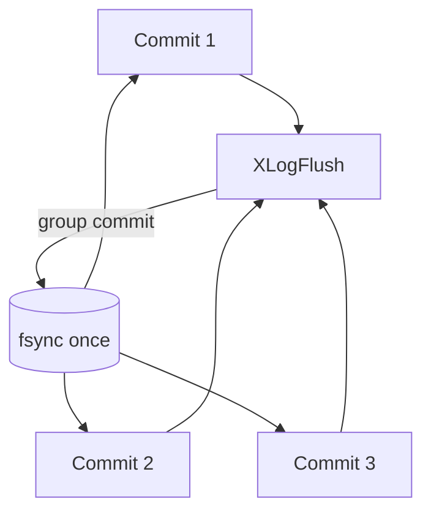

# Scalability and contention: locks, ProcArray, and WAL throughput

Shared-memory contention and the WAL flush path are potential PostgreSQL
scalability limits. Their importance depends on the workload and hardware. This
page maps mechanisms and observation points; it does not claim a measured
bottleneck without a representative benchmark.

## LWLocks: fast path, wait list, and tranches

The LWLock fast path is an atomic acquisition
attempt in `LWLockAttemptLock()`; when that fails, the waiter joins the lock's
wait list under `LWLockWaitListLock()`. `LWLockAcquire()` and `LWLockRelease()`
are the public entry points. `LWLockAcquireOrWait()` either acquires the lock
and returns true, or waits for it to become free and returns false without
owning it. A WAL-flush waiter can then recheck whether another backend already
performed the required flush.

Contention is reduced by **partitioning**:

- A fixed set of individual LWLocks (`NUM_INDIVIDUAL_LWLOCKS`) is followed by
  named tranches. `BUFFER_MAPPING_LWLOCK_OFFSET` is defined as
  `NUM_INDIVIDUAL_LWLOCKS`, so buffer-mapping locks live in their own tranche
  partitioned by the buffer-tag hash code, not by buffer ID:
  `BufTableHashPartition(hashcode)` computes `hashcode % NUM_BUFFER_PARTITIONS`.
- Subsystems obtain their tranche with `GetNamedLWLockTranche()`, and dynamic
  tranche ids come from `LWLockNewTrancheId()`.

Sources: `src/backend/storage/lmgr/lwlock.c` (`LWLockAcquire`,
`LWLockAttemptLock`, `LWLockWaitListLock`, `LWLockRelease`,
`GetNamedLWLockTranche`, `LWLockNewTrancheId`),
`src/include/storage/lwlock.h`.

## ProcArray and snapshots

The `ProcArray` tracks running transactions so snapshots and visibility checks
can be computed. Adding/removing a backend takes the `ProcArrayLock`:

- `ProcArrayAdd()` / `ProcArrayRemove()` register a backend.
- `ProcArrayEndTransaction()` clears a transaction id at commit/abort.
- `ProcArrayGroupClearXid()` lets one backend clear several xids in a batch —
  a group-commit-like mitigation when many backends commit simultaneously.
- `GetSnapshotData()` computes a snapshot; `TransactionIdIsInProgress()` checks
  whether a given xid is still running.
- `GetOldestNonRemovableTransactionId()` derives the oldest xid that vacuum and
  slot retention must preserve.

Grouped xid clearing amortizes contended transaction-end work. Recovery also
maintains known assigned XIDs, which serve recovery visibility semantics; do
not infer a performance improvement from their existence alone.

Sources: `src/backend/storage/ipc/procarray.c` (`ProcArrayAdd`,
`ProcArrayRemove`, `ProcArrayEndTransaction`, `ProcArrayGroupClearXid`,
`GetSnapshotData`, `TransactionIdIsInProgress`,
`GetOldestNonRemovableTransactionId`).

## WAL throughput and group commit

WAL flush is inherently serialized by durability, but it is made to scale by
**group commit**: waiters on `XLogFlush()` share a single flush and are woken
together. The `commit_delay` GUC (`CommitDelay` in C) can add a delay in
`XLogFlush()` when fsync is enabled and the `commit_siblings` threshold is met. The WAL writer flushes in the background using `wal_writer_delay` and
`wal_writer_flush_after` so commits have less synchronous work to do.

Insertion itself is parallelized by WAL insertion locks (see
[WAL I/O, WAL buffers, and the buffer manager](../io/wal-io-and-buffering.md)),
but this is a concurrency mechanism, not a guarantee of linear throughput
scaling. Measure both insert-lock and write/flush waits for the actual workload.

## Observability: wait events and pg_stat_io

Contention is diagnosed through wait events and I/O statistics:

- `pgstat_report_wait_start()` / `pgstat_report_wait_end()` annotate the
  current wait with a wait-event id; `wait_event.c` resolves names for the
  activity, buffer, client, IPC, timeout, and I/O categories.
- `pgstat_count_io_op()` accumulates I/O operation counts and timings that back
  `pg_stat_io`.

Practical loop: look at `pg_stat_activity.wait_event`, aggregate by
`wait_event_type`, then use `pg_stat_io` and the buffer/WAL statistics to decide
whether the bottleneck is lock contention, WAL flush, or reads.

Sources: `src/include/utils/wait_event.h` (`pgstat_report_wait_start`,
`pgstat_report_wait_end`), `src/backend/utils/activity/wait_event.c`,
`src/backend/utils/activity/pgstat_io.c` (`pgstat_count_io_op`).

## Related

- WAL insertion locks and buffer flushing: [WAL I/O, WAL buffers, and the buffer manager](../io/wal-io-and-buffering.md)
- Shared-memory map: [System map](../architecture/overview.md)
- Logical decoding, which also reads WAL: [Logical decoding](../replication/logical-decoding.md)
