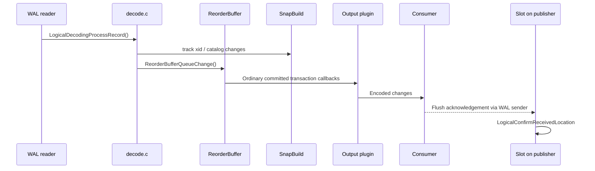

# Logical decoding and logical replication

Logical decoding reads the same WAL stream that physical replication ships, but
interprets it at the row/transaction level and hands changes to an **output
plugin**. The output can drive logical subscribers (`pgoutput`) or a custom
consumer. This page traces the path and the state that makes it consistent.

## Pipeline overview

## Starting a decoding context

`CheckLogicalDecodingRequirements()` validates the configuration.
`CreateInitDecodingContext()` creates a slot's decoding state; when no
`restart_lsn` is supplied it chooses one and sets `catalog_xmin`.
`CreateDecodingContext()` resumes an existing slot from its
`restart_lsn`. `DecodingContextFindStartpoint()` advances until a consistent
starting point is found, beginning the WAL reader at
`slot->data.restart_lsn`.

Sources: `src/backend/replication/logical/logical.c`
(`CheckLogicalDecodingRequirements`, `CreateInitDecodingContext`,
`CreateDecodingContext`, `DecodingContextFindStartpoint`).

## Decoding WAL records

`LogicalDecodingProcessRecord()` dispatches each WAL record by resource
manager:

| Op | Handler | Meaning |
| --- | --- | --- |
| `XLOG` | `DecodeXLogOp` | Checkpoint/redo bookkeeping |
| `XACT` | `DecodeXactOp` | Commit/abort/assignments |
| `STANDBY` | `DecodeStandbyOp` | Running-xacts, invalidation |
| `HEAP` / `HEAP2` | `DecodeHeapOp` / `DecodeHeap2Op` | Table changes |
| `LOGICALMSG` | `DecodeLogicalMsgOp` | Plugin messages |

Source: `src/backend/replication/logical/decode.c`
(`LogicalDecodingProcessRecord`, `DecodeXLogOp`, `DecodeXactOp`,
`DecodeStandbyOp`, `DecodeHeapOp`, `DecodeLogicalMsgOp`).

## The reorder buffer

WAL is ordered by LSN, not by transaction, so changes must be reassembled per
transaction before they can be replayed in commit order. The `ReorderBuffer`
does this:

- `ReorderBufferAllocate()` creates a buffer bound to a decoding context.
- `ReorderBufferQueueChange()` appends a change to a transaction's list.
- `ReorderBufferCommit()` / `ReorderBufferProcessTXN()` flush a committed
  transaction's changes to the plugin in a deterministic order.
- `ReorderBufferSetRestartPoint()` records the point the slot may restart from.
- `ReorderBufferXidHasCatalogChanges()` reports whether a transaction changed
  the catalog (relevant to snapshot maintenance).
- Under memory pressure, changes are serialized to disk
  (`ReorderBufferCheckMemoryLimit`, `ReorderBufferSerializeTXN`).

**Streaming** (logical replication of in-progress transactions) uses
`ReorderBufferCanStream()` and `ReorderBufferStreamTXN()` to emit changes
before commit, with stream stop/abort/prepare/commit callbacks.

Source: `src/backend/replication/logical/reorderbuffer.c`.

## The snapshot builder

Decoding needs a **historic snapshot**: a change must be interpreted using the
catalog as it looked at that point, not as it looks now. `SnapBuild` maintains
that view.

- `AllocateSnapshotBuilder()` creates it for the reorder buffer.
- `SnapBuildProcessChange()` tracks a transaction's first change so the builder
  can decide what to include.
- `SnapBuildFindSnapshot()` / `SnapBuildBuildSnapshot()` /
  `SnapBuildGetOrBuildSnapshot()` build the snapshot used to interpret catalog
  lookups.
- `SnapBuildExportSnapshot()` exports the initial snapshot so subscribers can
  create a consistent initial data copy.
- `SnapBuildXactNeedsSkip()` decides whether a transaction precedes the
  snapshot and must be skipped.
- `SnapBuildGetTwoPhaseAt()` / `SnapBuildSetTwoPhaseAt()` bound two-phase
  decoding.

Sources: `src/backend/replication/logical/snapbuild.c`
(`AllocateSnapshotBuilder`, `SnapBuildProcessChange`, `SnapBuildFindSnapshot`,
`SnapBuildBuildSnapshot`, `SnapBuildGetOrBuildSnapshot`,
`SnapBuildExportSnapshot`, `SnapBuildXactNeedsSkip`,
`SnapBuildGetTwoPhaseAt`, `SnapBuildSetTwoPhaseAt`).

## Origins and progress

Logical replication uses **replication origins** (`replorigin_*`) to record how
far a session has applied an origin's changes. This supports resume and
origin-aware filtering; progress tracking alone does not guarantee loop-free
bidirectional replication:

- `replorigin_create()` / `replorigin_drop_by_name()`.
- `replorigin_advance()` and `replorigin_session_advance()` advance progress.
- `replorigin_get_progress()` reads it; `replorigin_session_setup()` binds the
  current session to an origin.

Producer progress and consumer acknowledgement are different. The decoding
`update_progress_txn` wrapper reports an LSN and calls `OutputPluginUpdateProgress`;
it explicitly does not confirm receipt of the current transaction. In a
streaming connection, `ProcessStandbyReplyMessage()` passes the consumer's
flush acknowledgement to `LogicalConfirmReceivedLocation()`, which advances
`confirmed_flush` monotonically. SQL decoding and initial slot setup have
separate advancement paths; emitting plugin output is not a universal receipt
acknowledgement.

Sources: `src/backend/replication/logical/origin.c`,
`src/backend/replication/logical/logical.c` (`update_progress_txn_cb_wrapper`,
`confirmed_flush_lsn` handling).

## Output plugins and pgoutput

A plugin registers callbacks at startup: `startup`, `begin`, `change`,
`truncate`, `commit`, optional `message`, and the `stream_*` family for
streamed transactions. `pgoutput` is the built-in plugin used by logical
replication:

- `pgoutput_startup()` negotiates options and builds relation/publication state.
- `pgoutput_change()` encodes inserts/updates/deletes.
- `pgoutput_commit_txn()` emits the commit and reports producer progress;
  consumer acknowledgement is handled separately.
- `pgoutput_truncate()` handles `TRUNCATE`.

Source: `src/backend/replication/pgoutput/pgoutput.c`.

## The apply side

On a subscriber, background workers apply the stream:

- `logicalrep_worker_launch()` and `logicalrep_worker_find()` (launcher.c)
  manage worker processes.
- `ApplyWorkerMain()` (worker.c) runs the apply worker; a parallel apply worker
  path exists for streaming transactions.
- Table synchronization workers perform the initial copy.

Sources: `src/backend/replication/logical/worker.c` (`ApplyWorkerMain`),
`src/backend/replication/logical/launcher.c` (`logicalrep_worker_launch`,
`logicalrep_worker_find`), `src/backend/replication/logical/tablesync.c`.

## Slots and retention

Decoding depends on the slot to retain the WAL it still needs via
`restart_lsn`, and to keep catalog rows alive via `catalog_xmin`. See
[Replication slots](./replication-slots.md).
