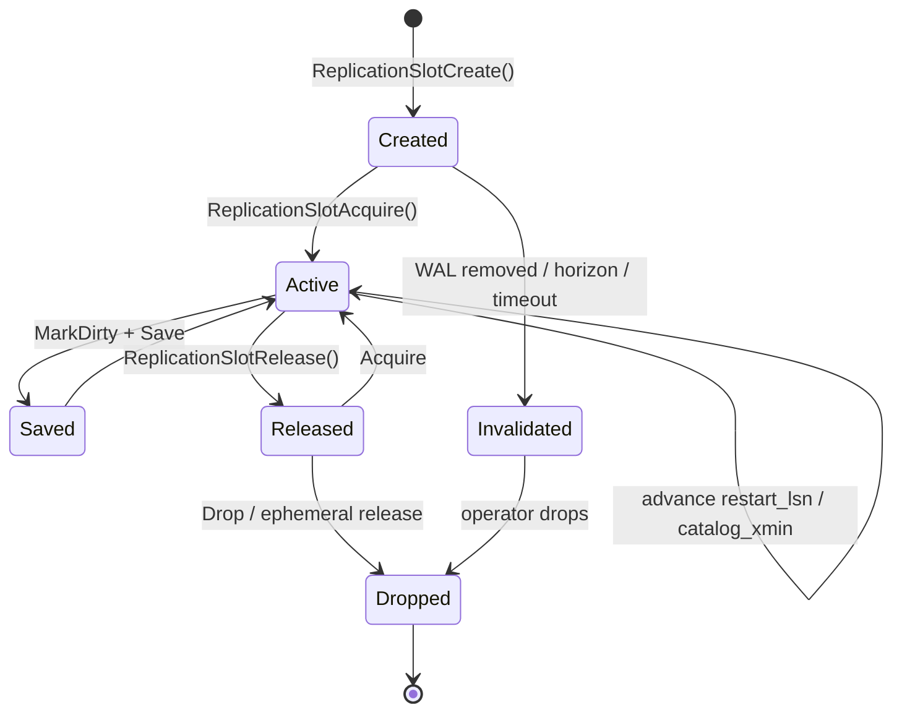

# Replication slots: persistence, invalidation, and synchronization

A replication slot records retention requirements for the WAL
(and catalog rows for logical decoding) that a consumer still needs. Persistent
slots survive disconnects and restarts; temporary and ephemeral slots have
different lifetimes. Slots support resumable streaming and logical decoding, and they are a
common source of surprises when a consumer stops.

## What a slot holds

Each slot lives under `pg_replslot` (`PG_REPLSLOT_DIR`) and carries:

- `restart_lsn` — the oldest WAL position still needed.
- `catalog_xmin` — (logical slots) the oldest catalog row version still needed.
- `confirmed_flush` — (logical slots) the last LSN the consumer confirmed.
- `two_phase` / `two_phase_at` — whether two-phase decoding is enabled and from
  which LSN.
- `failover` — whether the slot is a failover candidate to be synchronized to
  standbys.

Persistency is `RS_PERSISTENT`, `RS_EPHEMERAL`, or `RS_TEMPORARY`.
`ReplicationSlotCreate()` takes the name, whether the slot is database-specific
(logical), the persistency, and flags for `two_phase`, `repack`, `failover`,
and `synced`. Physical slots are not database-specific; logical slots are and
add the catalog/two-phase state.

Sources: `src/include/replication/slot.h` (`PG_REPLSLOT_DIR`,
`ReplicationSlotPersistency`, slot data fields, `ReplicationSlotCreate`),
`src/backend/replication/slot.c` (`ReplicationSlotCreate`).

## Acquire and release

A backend takes exclusive use of a slot for the duration of a connection or
decoding session:

- `ReplicationSlotAcquire(name, nowait, error_if_invalid)` claims the slot.
- `ReplicationSlotRelease()` releases it.
- `ReplicationSlotMarkDirty()` marks in-memory state dirty; it does not flush.
  `ReplicationSlotSave()` serializes slot state through `SaveSlotToPath()`, and
  `ReplicationSlotPersist()` changes persistency and saves the slot.
- `ReplicationSlotDropAcquired()` drops the currently acquired slot.

Ephemeral slots are special: `ReplicationSlotRelease()` drops an `RS_EPHEMERAL`
slot when it is released. This is intentional lifecycle behavior. A proposed
race or bug requires separate reproduction evidence; it is not established
merely by this cleanup path.

Source: `src/backend/replication/slot.c` (`ReplicationSlotAcquire`,
`ReplicationSlotRelease`, `ReplicationSlotMarkDirty`, `ReplicationSlotSave`,
`ReplicationSlotPersist`, `ReplicationSlotDropAcquired`).

## Retention accounting

Slot state feeds global retention decisions so vacuum and WAL removal keep what
consumers need:

- `ReplicationSlotsComputeRequiredXmin()` — the oldest xmin any slot requires.
- `ReplicationSlotsComputeRequiredLSN()` — the oldest restart LSN required.
- `ReplicationSlotsComputeLogicalRestartLSN()` — the logical restart floor.

A valid slot whose consumer has stopped therefore holds WAL and delays vacuum;
monitoring `pg_replication_slots` is the way to catch this.

Source: `src/backend/replication/slot.c` (`ReplicationSlotsComputeRequiredXmin`,
`ReplicationSlotsComputeRequiredLSN`,
`ReplicationSlotsComputeLogicalRestartLSN`).

## Invalidation

When a slot can no longer be used, PostgreSQL does **not** silently drop a
persistent slot. It records an invalidation cause and surfaces it, so the loss
is explicit. Causes (`RS_INVAL_*`) include WAL removed, xmin horizon, WAL level
change, and idle timeout.

- `ReplicationSlotReserveWal()` pins a restart point for a new slot.
- `ReportSlotInvalidation()` / `DetermineSlotInvalidationCause()` classify and
  record the cause.
- `InvalidatePossiblyObsoleteSlot()` and `InvalidateObsoleteReplicationSlots()`
  invalidate affected slots (for example when `max_slot_wal_keep_size` is
  exceeded or the horizon advances too far).

Because the failure is reported rather than silently dropping the slot, an
operator or the database must act: an invalidated logical slot must be
recreated with a suitable data-resynchronization procedure before reuse; do
not assume that advancing its LSN repairs the invalidation.

Source: `src/backend/replication/slot.c` (`ReplicationSlotReserveWal`,
`ReportSlotInvalidation`, `DetermineSlotInvalidationCause`,
`InvalidatePossiblyObsoleteSlot`, `InvalidateObsoleteReplicationSlots`),
`src/include/replication/slot.h` (`RS_INVAL_*`).

## Synchronized and failover slots

A standby that may be promoted needs the primary's logical slots to exist
locally. The **slot synchronization** worker copies failover-enabled slots from
the primary:

- `synchronized_standby_slots` lists physical standby slots that logical
  failover decoding waits for. Changes must reach and be flushed on those
  standbys before the logical failover stream advances. This also gates the
  logical failover SQL decoding/advance functions; it is not simply a WAL
  deletion switch. Missing or invalid listed slots can stall the logical stream.
- `ReplSlotSyncWorkerMain()` runs the sync worker;
  `ValidateSlotSyncParams()` validates configuration and
  `slotsync_reread_config()` picks up changes.
- `fetch_remote_slots()` / `synchronize_slots()` /
  `synchronize_one_slot()` mirror remote slots locally;
  `update_and_persist_local_synced_slot()` writes state and
  `drop_local_obsolete_slots()` removes slots no longer on the primary.

Sources: `src/backend/replication/logical/slotsync.c`
(`ReplSlotSyncWorkerMain`, `ValidateSlotSyncParams`, `slotsync_reread_config`,
`fetch_remote_slots`, `synchronize_slots`, `synchronize_one_slot`,
`update_and_persist_local_synced_slot`, `drop_local_obsolete_slots`),
`src/include/replication/slot.h` (`synchronized_standby_slots`).

## Lifecycle

## Related

- Logical decoding that consumes logical slots: [Logical decoding](./logical-decoding.md)
- Streaming that consumes physical slots: [WAL sender](./walsender.md)
- Slots on standbys and promotion: [WAL receiver and hot standby](./walreceiver-and-hot-standby.md)
