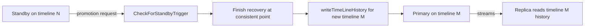

# Timelines, WAL recovery, and promotion

Recovery is the consumer side of the WAL path: the startup process reads WAL
records and replays them. The **timeline** records the recovery history so a
cluster that has been promoted does not confuse valid WAL from its previous
incarnations. This page connects redo, timeline selection, restartpoints, and
promotion.

## Timelines and history files

Every promotion creates a new `TimeLineID` and writes a `.history` file
recording the parent timeline and the LSN where the switch happened. The history
file is what lets recovery decide which timeline a requested WAL location
belongs to.

- `readTimeLineHistory()` reads a timeline's ancestry.
- `writeTimeLineHistory()` / `writeTimeLineHistoryFile()` write a new history
  file on promotion.
- `restoreTimeLineHistoryFiles()` restores history files from the archive.
- `existsTimeLineHistory()` / `findNewestTimeLine()` discover timelines.
- `tliInHistory()`, `tliOfPointInHistory()`, and `tliSwitchPoint()` resolve
  which timeline owns a point, and where a switch occurred.

Source: `src/backend/access/transam/timeline.c` (`readTimeLineHistory`,
`writeTimeLineHistory`, `writeTimeLineHistoryFile`,
`restoreTimeLineHistoryFiles`, `existsTimeLineHistory`, `findNewestTimeLine`,
`tliInHistory`, `tliOfPointInHistory`, `tliSwitchPoint`).

## Recovery: reading and replaying WAL

`InitWalRecovery()` sets up recovery from the control file and any backup label,
reading a signal file and validating parameters. `PerformWalRecovery()` is the
main loop: it reads records with `ReadRecord()`, validates timeline switches with
`checkTimeLineSwitch()`, and applies records with `ApplyWalRecord()`. The
record-specific redo operation is `GetRmgr(record->xl_rmid).rm_redo(...)`.
`xlogrecovery_redo()` separately handles recovery-related XLOG bookkeeping; it
is not the general redo dispatcher.

When WAL is not local, `WaitForWALToBecomeAvailable()` decides whether to pull
from the archive or from streaming (`XLogFileRead`, `XLogFileReadAnyTLI`).
`CheckRecoveryConsistency()` marks the point at which the system is consistent
enough to accept read-only queries on a hot standby.

- `readRecoverySignalFile()` — detect `standby.signal` and `recovery.signal`
  during initialization, not a promotion request.
- `validateRecoveryParameters()` — validate recovery target settings.
- `CheckRecoveryConsistency()` — establish consistency.

Source: `src/backend/access/transam/xlogrecovery.c` (`InitWalRecovery`,
`readRecoverySignalFile`, `validateRecoveryParameters`, `PerformWalRecovery`,
`ApplyWalRecord`, `xlogrecovery_redo`, `ReadRecord`, `checkTimeLineSwitch`,
`WaitForWALToBecomeAvailable`, `XLogFileRead`, `XLogFileReadAnyTLI`,
`CheckRecoveryConsistency`).

### Timeline selection in the WAL reader

The WAL reader itself must pick the right segment when a timeline switch is in
its path. `XLogReadDetermineTimeline()` performs that decision for the reader,
and `read_local_xlog_page()` / `read_local_xlog_page_guts()` service the local
read. During cascading recovery, `rescanLatestTimeLine()` notices a newer
timeline appearing.

Source: `src/backend/access/transam/xlogutils.c`
(`XLogReadDetermineTimeline`, `read_local_xlog_page`,
`read_local_xlog_page_guts`), `src/backend/access/transam/xlogrecovery.c`
(`rescanLatestTimeLine`, `XLogFileReadAnyTLI`).

## Recovery targets, pause, and apply delay

Recovery can stop at a target, pause for inspection, or deliberately lag:

- `recoveryStopsBefore()` / `recoveryStopsAfter()` decide whether a record
  reaches the configured recovery target; `getRecoveryStopReason()` reports why.
- `recovery_target_*` GUCs select the target (time, xid, LSN, name, immediate).
- `recoveryPausesHere()` and `SetRecoveryPause()` implement
  `pg_wal_replay_pause()`; `GetRecoveryPauseState()` reports it.
- `recoveryApplyDelay()` honors `recovery_min_apply_delay`, delaying replay of
  commit-like records.

Source: `src/backend/access/transam/xlogrecovery.c` (`recoveryStopsBefore`,
`recoveryStopsAfter`, `getRecoveryStopReason`, `recoveryPausesHere`,
`SetRecoveryPause`, `GetRecoveryPauseState`, `recoveryApplyDelay`).

## Standby checkpoints (restartpoints)

A standby cannot write a normal checkpoint, but it must still flush dirty data
and bound recovery work. It creates a **restartpoint**:

- Recovery records the last checkpoint it can restart from with
  `RecoveryRestartPoint()`.
- `CreateRestartPoint()` flushes dirty buffers via `CheckPointGuts()`, logs with
  `LogCheckpointStart(..., restartpoint = true)`, and advances control-file
  state.

A restartpoint uses an already replayed safe checkpoint as its recovery base,
rather than generating a primary checkpoint record. Retention still also
depends on consumers such as slots;
see [Replication slots](./replication-slots.md).

Source: `src/backend/access/transam/xlog.c` (`RecoveryRestartPoint`,
`CreateRestartPoint`, `CheckPointGuts`, `LogCheckpointStart`).

## Promotion

Promotion turns a standby into a primary. It is requested by the operator (for
example `pg_ctl promote` or `pg_promote()`), and the startup process notices,
stops replay at a consistent point, and switches to a new timeline.

- `CheckForStandbyTrigger()` checks the promotion signal and promotion
  request file during recovery. `readRecoverySignalFile()` has the separate
  startup role of selecting recovery/standby mode.
- `SetPromoteIsTriggered()` / `PromoteIsTriggered()` publish the promotion state;
  `LocalPromoteIsTriggered` tracks it locally.
- A new timeline history file is written via `writeTimeLineHistory()`.

Source: `src/backend/access/transam/xlogrecovery.c`
(`readRecoverySignalFile`, `CheckForStandbyTrigger`, `SetPromoteIsTriggered`,
`PromoteIsTriggered`), `src/backend/access/transam/timeline.c`
(`writeTimeLineHistory`).

## Related

- WAL buffer/flush side: [WAL I/O, WAL buffers, and the buffer manager](../io/wal-io-and-buffering.md)
- Receiving and replaying on a standby: [WAL receiver and hot standby](./walreceiver-and-hot-standby.md)
- Streaming from the primary: [WAL sender](./walsender.md)
