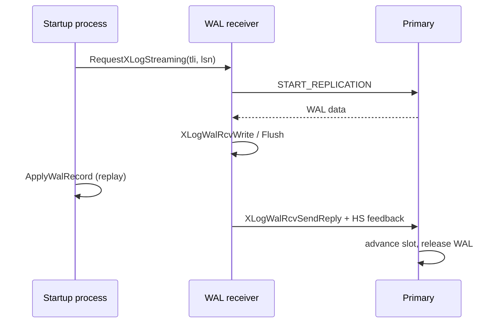

# WAL receiver and hot standby

A standby has two cooperating pieces: a **WAL receiver** process that streams
WAL from the primary and writes it to `pg_wal`, and the **startup process** that
replays it while the system serves read-only queries. This page covers the
receiver, the position feedback, and the conflict resolution that keeps replay
from being blocked forever.

## Connecting and streaming

The startup process requests a stream with `RequestXLogStreaming()`, providing
the timeline and start LSN, and the receiver begins at
`WalReceiverMain()`. It waits for a start position with
`WalRcvWaitForStartPosition()` and fetches any missing timeline history files
with `WalRcvFetchTimeLineHistoryFiles()`.

Incoming messages are decoded by `XLogWalRcvProcessMsg()`; WAL data is written
by `XLogWalRcvWrite()` and flushed by `XLogWalRcvFlush()`. `XLogWalRcvClose()`
handles the end of a segment. On shutdown, `ShutdownWalRcv()` stops the worker
and `WalRcvDie()` runs the exit path.

Sources: `src/backend/replication/walreceiverfuncs.c`
(`RequestXLogStreaming`, `ShutdownWalRcv`, `WalRcvRunning`, `WalRcvStreaming`,
`WalRcvGetState`), `src/backend/replication/walreceiver.c`
(`WalReceiverMain`, `WalRcvWaitForStartPosition`,
`WalRcvFetchTimeLineHistoryFiles`, `XLogWalRcvProcessMsg`, `XLogWalRcvWrite`,
`XLogWalRcvFlush`, `XLogWalRcvClose`, `WalRcvDie`).

## Position tracking

Three positions matter and are distinct:

| Position | Getter | Meaning |
| --- | --- | --- |
| Received/written | `GetWalRcvWriteRecPtr()` | WAL written to the standby's `pg_wal` |
| Flushed | `GetWalRcvFlushRecPtr()` | WAL fsync'd on the standby |
| Applied/replayed | `GetXLogReplayRecPtr()` | WAL replayed by the startup process |

`GetXLogReceiptTime()` reports when the current WAL was received, which frames
`GetReplicationApplyDelay()` and `GetReplicationTransferLatency()`. These feed
`synchronous_commit` semantics and `pg_stat_wal_receiver`
(`pg_stat_get_wal_receiver`).

Source: `src/backend/replication/walreceiverfuncs.c`
(`GetWalRcvFlushRecPtr`, `GetWalRcvWriteRecPtr`, `GetReplicationApplyDelay`,
`GetReplicationTransferLatency`), `src/backend/replication/walreceiver.c`
(`pg_stat_get_wal_receiver`),
`src/backend/access/transam/xlogrecovery.c` (`GetXLogReplayRecPtr`,
`GetXLogReceiptTime`).

## Feedback to the primary

The receiver sends the primary its progress so the primary can advance the
standby's slot and release WAL:

- `XLogWalRcvSendReply()` reports write/flush/apply positions.
- `ProcessWalSndrMessage()` handles the primary's reply (its WAL end and time).
- `XLogWalRcvSendHSFeedback()` sends **hot-standby feedback**, including the
  standby's xmin and catalog xmin horizons, to protect row versions needed by
  standby queries and logical decoding. This reduces cleanup conflicts; it
  does not eliminate all recovery-conflict classes.
- `WalRcvComputeNextWakeup()` schedules the next reply;
  `WalRcvRequestApplyReply()` forces one when the apply position advances.

Source: `src/backend/replication/walreceiver.c` (`XLogWalRcvSendReply`,
`ProcessWalSndrMessage`, `XLogWalRcvSendHSFeedback`,
`WalRcvComputeNextWakeup`, `WalRcvRequestApplyReply`).

## Recovery conflicts

Replay must sometimes wait for a read-only query that is using data it wants to
change or truncate. The `RecoveryConflictReason` reasons are:

- `RECOVERY_CONFLICT_LOCK` — a backend holds a lock blocking replay.
- `RECOVERY_CONFLICT_SNAPSHOT` — a backend holds a snapshot blocking cleanup.
- `RECOVERY_CONFLICT_LOGICALSLOT` — a logical slot must be invalidated.
- `RECOVERY_CONFLICT_BUFFERPIN` — a buffer pin blocks replay.
- `RECOVERY_CONFLICT_STARTUP_DEADLOCK` and
  `RECOVERY_CONFLICT_BUFFERPIN_DEADLOCK` — deadlock resolution involving the
  startup process.

Resolution functions wait, cancel queries, or terminate conflicting sessions
according to the conflict class and applicable delay rules:

- `ResolveRecoveryConflictWithSnapshot()` / `...SnapshotFullXid()`.
- `ResolveRecoveryConflictWithVirtualXIDs()`, `...Tablespace()`,
  `...Database()`, `...Lock()`, and `ResolveRecoveryConflictWithBufferPin()`.
- `CheckRecoveryConflictDeadlock()` with `StandbyDeadLockHandler()`,
  `StandbyTimeoutHandler()`, and `StandbyLockTimeoutHandler()`.
- `WaitExceedsMaxStandbyDelay()` enforces `max_standby_streaming_delay` /
  `max_standby_archive_delay`; `LogRecoveryConflict()` records the conflict.

For a buffer-pin conflict, trace the holder, startup-process wait, and
wakeup/cancellation path. Claims about a particular premature-wakeup bug need
a separate reproducer and patch review.

Sources: `src/include/storage/standby.h` (`RecoveryConflictReason`),
`src/backend/storage/ipc/standby.c` (`ResolveRecoveryConflictWithSnapshot`,
`ResolveRecoveryConflictWithVirtualXIDs`,
`ResolveRecoveryConflictWithTablespace`, `ResolveRecoveryConflictWithDatabase`,
`ResolveRecoveryConflictWithLock`, `ResolveRecoveryConflictWithBufferPin`,
`SendRecoveryConflictWithBufferPin`, `CheckRecoveryConflictDeadlock`,
`StandbyDeadLockHandler`, `StandbyTimeoutHandler`, `WaitExceedsMaxStandbyDelay`,
`GetStandbyLimitTime`, `LogRecoveryConflict`).

## Promotion interaction

When finishing recovery, `FinishWalRecovery()` calls `XLogShutdownWalRcv()`
before writing new local WAL, so a live receiver cannot overwrite those records.
Do not describe promotion as a request to restart the receiver. Promotion also
switches the node to a new timeline.
See [Timelines, WAL recovery, and promotion](./timeline-and-recovery.md).

## Related

- Physical slot that retains the WAL: [Replication slots](./replication-slots.md)
- Replay and timeline logic: [Timelines, WAL recovery, and promotion](./timeline-and-recovery.md)
- Sender side: [WAL sender](./walsender.md)
