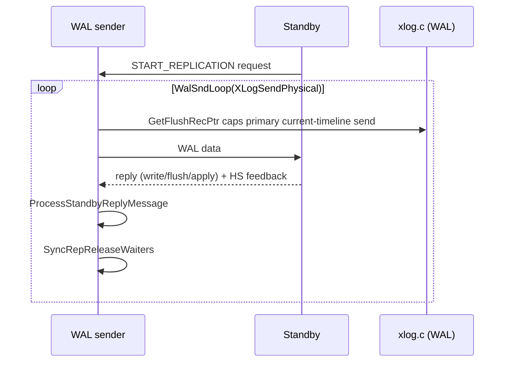

# WAL sender: physical streaming and synchronous replication

A walsender is a backend that has switched into replication command mode. It
reads WAL (physical or logical) and streams it to a standby or subscriber, and
it processes the acknowledgements that make synchronous replication work. This
page covers the send loop, feedback, the synchronous wait, and termination.

## Entering replication mode and command handling

Replication commands are recognized and dispatched by
`exec_replication_command()`. The substantive entry points are:

- `StartReplication()` — begin physical streaming from a timeline and LSN.
- `StartLogicalReplication()` — begin logical decoding and streaming.
- `ReadReplicationSlot()`, `CreateReplicationSlot()`, `DropReplicationSlot()`,
  `AlterReplicationSlot()` — slot management over the replication protocol.
- `IdentifySystem()`, `SendTimeLineHistory()` — identity and timeline history.

`InitWalSender()` / `InitWalSenderSlot()` set up shared sender state, and
`WalSndErrorCleanup()` unwinds on error.

Source: `src/backend/replication/walsender.c` (`exec_replication_command`,
`StartReplication`, `StartLogicalReplication`, `ReadReplicationSlot`,
`CreateReplicationSlot`, `DropReplicationSlot`, `AlterReplicationSlot`,
`IdentifySystem`, `SendTimeLineHistory`, `InitWalSender`, `InitWalSenderSlot`,
`WalSndErrorCleanup`).

## The send loop

`WalSndLoop()` is the main loop; it takes a send callback:
`XLogSendPhysical()` for physical streaming or `XLogSendLogical()` for logical
decoding. For the current primary timeline, `XLogSendPhysical()` caps sendable
WAL at `GetFlushRecPtr()`; cascading senders use `GetStandbyFlushRecPtr()`, and
historic timelines stop at their switch point. `WalSndWaitForWal()` belongs to
the logical WAL-reading wait path. `ProcessPendingWrites()` drains pending
output; `WalSndUpdateProgress()` reports logical-decoding progress and lag.

Timeout and sleep pacing are handled by `WalSndComputeSleeptime()`,
`WalSndCheckTimeOut()` (for `wal_sender_timeout`), and
`WalSndCheckShutdownTimeout()`.

Source: `src/backend/replication/walsender.c` (`WalSndLoop`,
`XLogSendPhysical`, `XLogSendLogical`, `WalSndWaitForWal`,
`ProcessPendingWrites`, `WalSndUpdateProgress`, `WalSndComputeSleeptime`,
`WalSndCheckTimeOut`, `WalSndCheckShutdownTimeout`).

## Keepalive, reply, and feedback

The sender sends keepalives with `WalSndKeepalive()` /
`WalSndKeepaliveIfNecessary()` and reads the standby's messages in
`ProcessRepliesIfAny()` -> `ProcessStandbyMessage()`:

- `ProcessStandbyReplyMessage()` updates the standby's reported write/flush/
  apply positions.
- `ProcessStandbyHSFeedbackMessage()` applies **hot-standby feedback** (the
  standby's xmin/catalog xmin), so the primary retains rows the standby needs.
- `ProcessStandbyPSRequestMessage()` handles a requested start position.

Applying feedback uses `PhysicalConfirmReceivedLocation()` (or the logical
equivalent) and, for physical slots, `PhysicalReplicationSlotNewXmin()`.
`TransactionIdInRecentPast()` guards against a stale feedback xmin before it is
trusted. When WAL is flushed, `WalSndWakeup()` (and
`PhysicalWakeupLogicalWalSnd()`) wakes waiting senders.

Source: `src/backend/replication/walsender.c` (`WalSndKeepalive`,
`WalSndKeepaliveIfNecessary`, `ProcessRepliesIfAny`, `ProcessStandbyMessage`,
`ProcessStandbyReplyMessage`, `ProcessStandbyHSFeedbackMessage`,
`ProcessStandbyPSRequestMessage`, `PhysicalConfirmReceivedLocation`,
`PhysicalReplicationSlotNewXmin`, `TransactionIdInRecentPast`, `WalSndWakeup`,
`PhysicalWakeupLogicalWalSnd`).

## Synchronous replication

Synchronous replication is the mirror image of WAL flush: a committer waits
until a standby has acknowledged a position, according to the configured
`synchronous_commit` level.

- `SyncRepWaitForLSN()` places the committer on a wait queue keyed by the
  required acknowledgement mode (write, flush, or apply).
- `SyncRepReleaseWaiters()` runs when a walsender observes new feedback and
  releases waiters whose LSN is now covered; `SyncRepWakeQueue()` does the
  actual wakeups.
- `SyncRepGetSyncRecPtr()`, `SyncRepGetOldestSyncRecPtr()`, and
  `SyncRepGetNthLatestSyncRecPtr()` compute the acknowledgement position for
  `FIRST`, `ANY`, and quorum-style configurations.
- `SyncRepGetCandidateStandbys()` / `SyncRepGetStandbyPriority()` rank
  standbys; `SyncRepInitConfig()` sets up reception, and
  `SyncRepCleanupAtProcExit()` cleans up.

Physical streaming on the primary sends only through its local flush position.
Remote feedback must still be interpreted by mode: `remote_write` confirms a
standby OS write, not a standby disk flush; `on` waits for remote flush when
synchronous replication is configured; `remote_apply` waits for replay.
`local` and `off` do not request a remote wait. Do not equate every reply with
remote crash durability.

Source: `src/backend/replication/syncrep.c` (`SyncRepWaitForLSN`,
`SyncRepReleaseWaiters`, `SyncRepWakeQueue`, `SyncRepGetSyncRecPtr`,
`SyncRepGetOldestSyncRecPtr`, `SyncRepGetNthLatestSyncRecPtr`,
`SyncRepGetCandidateStandbys`, `SyncRepGetStandbyPriority`, `SyncRepInitConfig`,
`SyncRepCleanupAtProcExit`).

## Timeline changes and termination

- `SendTimeLineHistory()` serves a timeline history file to a standby that has
  requested it, and `WalSndSegmentOpen()` opens WAL segments as the sender
  advances. If a requested timeline/segment is no longer available (recycled),
  the sender raises an error and the connection ends, prompting the standby to
  renegotiate.
- `WalSndKill()` is the on-exit callback; `WalSndShutdown()` and
  `WalSndDone()`/`WalSndDoneImmediate()` terminate the sender cleanly.

See [Timelines, WAL recovery, and promotion](./timeline-and-recovery.md)
for how the standby selects a timeline, and
[WAL receiver and hot standby](./walreceiver-and-hot-standby.md)
for the other side of the connection.

Source: `src/backend/replication/walsender.c` (`SendTimeLineHistory`,
`WalSndSegmentOpen`, `WalSndKill`, `WalSndShutdown`, `WalSndDone`,
`WalSndDoneImmediate`).

## Related

- Physical slot retaining the WAL: [Replication slots](./replication-slots.md)
- Receiver side: [WAL receiver and hot standby](./walreceiver-and-hot-standby.md)
- Timeline selection: [Timelines, WAL recovery, and promotion](./timeline-and-recovery.md)
